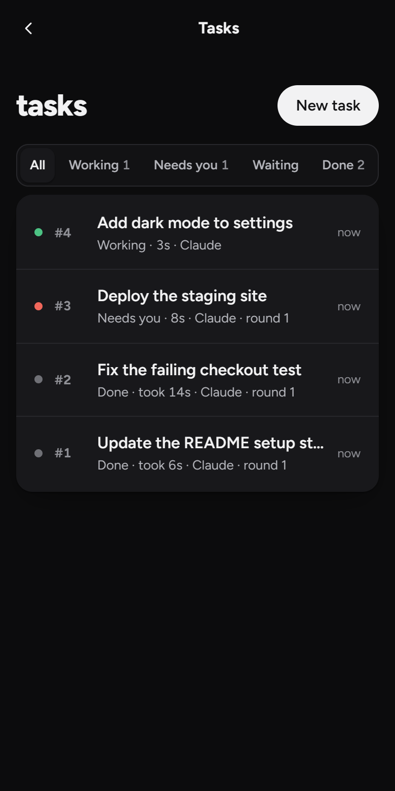
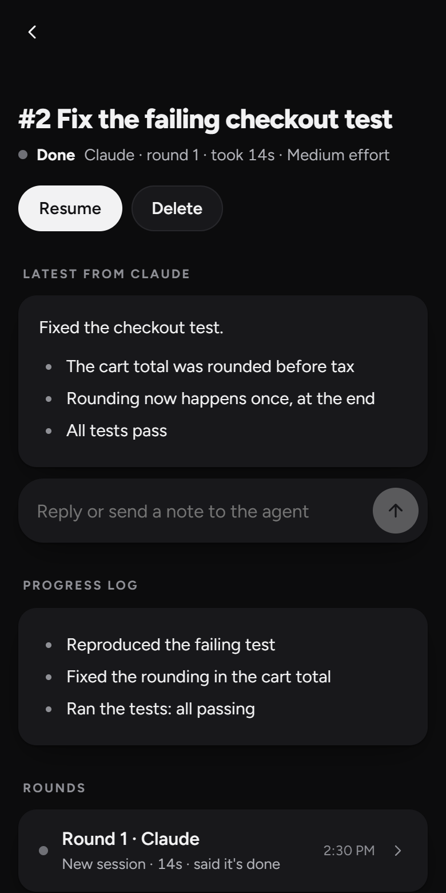
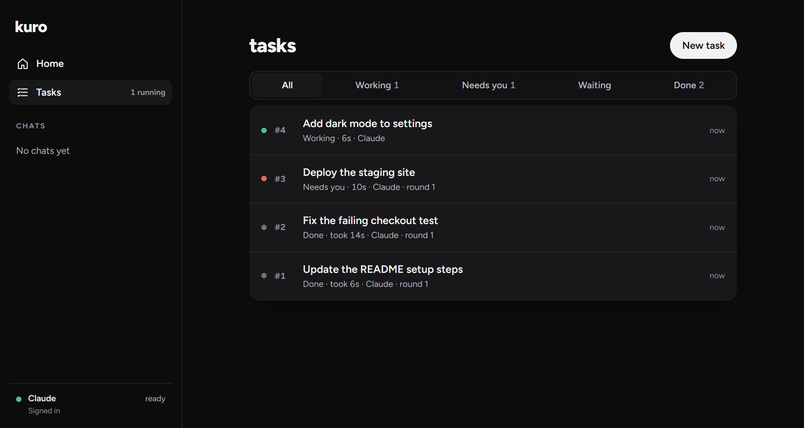

# Kuro

**Run Claude Code from your phone.** Start a coding task on your Windows PC, walk away, and check on it from anywhere. Works with Codex too.

<p align="center">
  
  
  
</p>

<p align="center">
  
</p>

## What it does

- **Start tasks remotely** in any project folder on your PC
- **See what needs you** at a glance, then reply or resume
- **Get past usage limits** by handing off to another account or Codex, or waiting for the reset
- **Get a second opinion** on High effort, where Codex reviews Claude's work and vice versa
- **Pick up after restarts** from saved sessions

## Quickstart

You need Windows, [Node.js 22+](https://nodejs.org/), [Git](https://git-scm.com/downloads/win), and [Claude Code](https://code.claude.com/docs/en/setup) signed in. Nothing else to install.

```powershell
git clone https://github.com/haynoke/kuro.git
cd kuro
Copy-Item config.example.json config.json
```

In `config.json`, set `accounts` to use Claude Code (or [use Codex](docs/guide.md#use-codex)):

```json
"accounts": [{ "name": "Claude", "engine": "claude", "env": {} }]
```

```powershell
node scripts/doctor.js
node server.js
```

Open [localhost:8790](http://localhost:8790) and start a task.

> Kuro never skips permissions. [Allow the edits and commands](https://code.claude.com/docs/en/permissions) your tasks need in Claude Code, or they stop at **Needs you**.

## Phone access

1. Install [Tailscale](https://tailscale.com/download) on your PC and phone, using the same account.
2. Run `tailscale serve --bg http://127.0.0.1:8790` and copy the `https://...ts.net` address.
3. In `config.json`, set `remoteAccess` to `true` and `publicOrigin` to that address, without a trailing slash.
4. Restart Kuro with a password:

   ```powershell
   $env:KURO_AUTH_TOKEN = node scripts/token.js
   $env:KURO_AUTH_TOKEN
   node server.js
   ```

5. Open the address on your phone. Username is `kuro`, password is the printed token.

Keep your PC awake. Do not use Tailscale Funnel or port forwarding.

## More

- [Guide](docs/guide.md): Codex, multiple accounts, local chat, voice, desktop control, settings, troubleshooting
- [Security](SECURITY.md)

## License

[MIT](LICENSE)
