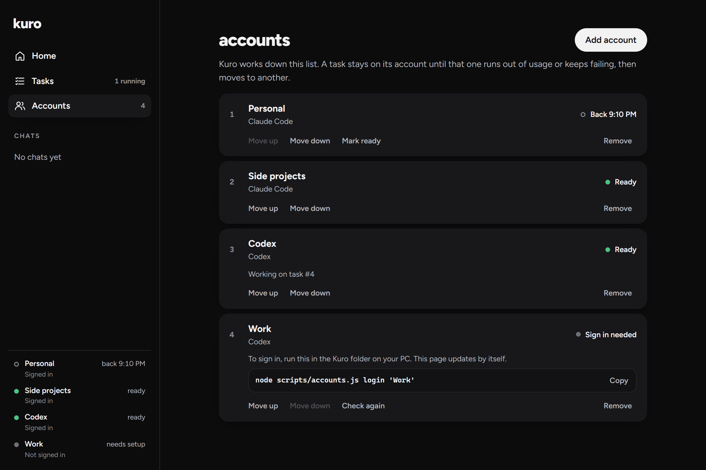
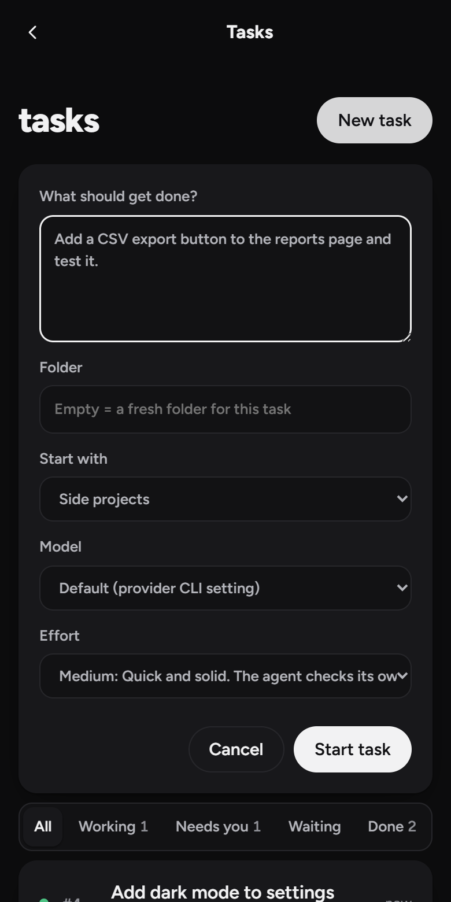
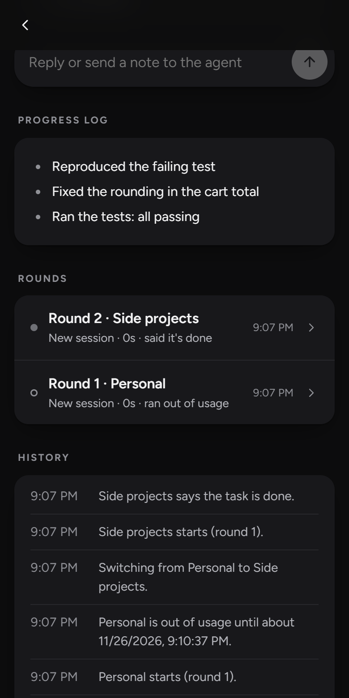
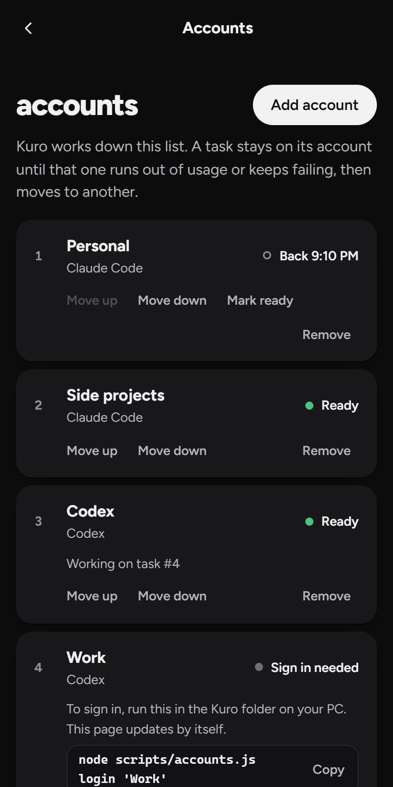

# Kuro

**An open-source orchestrator for coding agents.** Hand it tasks and set how they should be delegated. Kuro runs them on Claude Code and Codex, switches accounts when one runs out of usage, and keeps the work going.

## Quickstart

**Send this to your coding agent:**

```text
Install Kuro from https://github.com/haynoke/kuro securely and safely.
```

It should follow the [install steps for agents](docs/guide.md#install-with-your-coding-agent), which keep permissions on and leave sign-in to you.

**Or install it yourself.** You need Windows, [Node.js 22+](https://nodejs.org/), [Git](https://git-scm.com/downloads/win), and at least one coding agent CLI: [Claude Code](https://code.claude.com/docs/en/setup) or [Codex](docs/guide.md#install-a-coding-agent). Nothing else to install.

```powershell
git clone https://github.com/haynoke/kuro.git
cd kuro
node scripts/accounts.js add claude   # or: add codex
node server.js
```

Open [localhost:8790](http://localhost:8790) and start a task.

> Kuro never skips permissions. Allow what your tasks need in the agent's own settings ([Claude Code permissions](https://code.claude.com/docs/en/permissions), [Codex Windows sandbox](https://learn.chatgpt.com/docs/windows/windows-sandbox)), or they stop at **Needs you**.

<p align="center">
  
</p>

## Why Kuro

The agents write the code. Kuro is the harness around them that decides who works on what, and what happens next.

- **Delegation on your terms.** Choose the account order, where each task starts, its model and how carefully it is checked.
- **Automatic account switching.** When an account runs out of usage or keeps failing, the task moves to another one. If all are out, it waits and resumes after the reset.
- **Any number of accounts.** One or twenty, from either provider. Add, remove and reorder them while Kuro runs.
- **Handoffs that carry on.** Agents keep a progress log, so the next account continues from what is already done.
- **Open source.** MIT licensed, runs on your PC, plain Node.js with no npm packages.

## Delegate your way

| You decide | Where |
| --- | --- |
| Which account is used first | Order on the **Accounts** page |
| Where a task starts | **Start with**: first free account, any account from one provider, or one specific account |
| Which model does it | **Model**, per task |
| How carefully it is done | **Effort**: Low and Medium use one agent, High adds a review by a different provider |
| How many tasks run at once | `maxParallel` in `config.json` |
| How long it keeps trying | `maxRounds` and `reviewRounds` in `config.json` |

<p align="center">
  
  
  
</p>

<p align="center">
  
</p>

## Accounts

Add as many as you like, from the **Accounts** page or the command line:

```powershell
node scripts/accounts.js add claude Work       # a name is optional
node scripts/accounts.js add codex Personal
node scripts/accounts.js list
node scripts/accounts.js move Personal 1       # use it first
node scripts/accounts.js remove Work
```

The first account for each provider reuses the sign-in already on your PC. Every further one gets its own, and `add` opens the provider's sign-in for it. Changes apply without a restart.

Only add accounts you are allowed to use, and check each provider's terms, including any limits on using several accounts.

## Check on it from anywhere

1. Install [Tailscale](https://tailscale.com/download) on your PC and phone, using the same account.
2. Run `tailscale serve --bg http://127.0.0.1:8790` and copy the `https://...ts.net` address.
3. In `config.json`, set `remoteAccess` to `true` and `publicOrigin` to that address, without a trailing slash.
4. Restart Kuro with a password:

   ```powershell
   $env:KURO_AUTH_TOKEN = node scripts/token.js
   $env:KURO_AUTH_TOKEN
   node server.js
   ```

5. Open the address on your phone. Username is `kuro`, password is the printed token.

Keep your PC awake. Do not use Tailscale Funnel or port forwarding.

## More

- [Guide](docs/guide.md): accounts, how tasks move, local chat, voice, desktop control, settings, troubleshooting
- [Security](SECURITY.md)

## License

[MIT](LICENSE)
